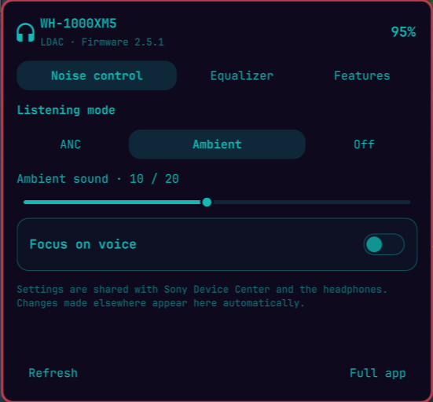
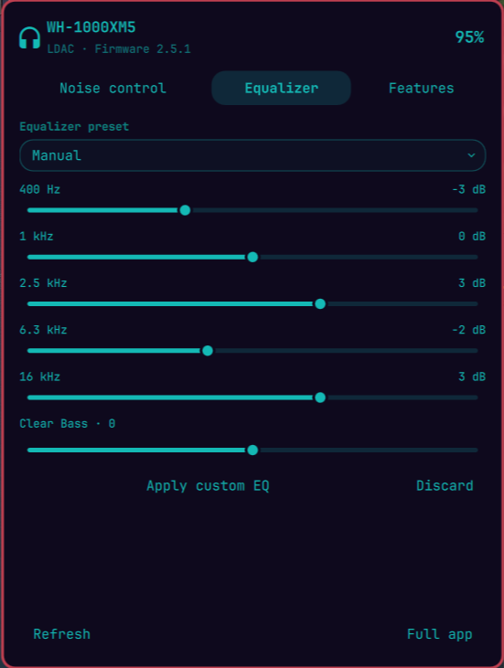
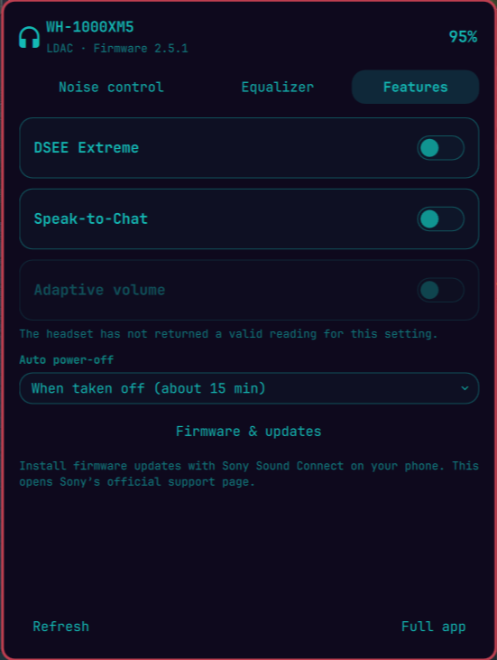

# Sony Headset for Omarchy

Sony Device Center controls in an Omarchy top-bar dropdown. Unofficial community
plugin, with no phone required for everyday headset adjustments.



## Features

- ANC, Ambient, Off, ambient level, and Focus on Voice.
- Five-band equalizer, Sony presets, Clear Bass, and explicit Apply/Discard.
- DSEE, Speak-to-Chat, adaptive volume when readable, and auto power-off.
- Battery, Bluetooth codec, firmware, and official firmware-update guidance.
- Native Omarchy theming, shared state across monitors, and keyboard controls.

Unknown, stale, and unsupported readings disable the corresponding controls.
Opening the panel never changes a headphone setting. EQ drafts survive failed
saves and are cleared when a different headset connects.

## Requirements and compatibility

Tested with **WH-1000XM5, firmware 2.5.1**, Omarchy **4.5.0-3**, Quickshell
**0.3.2.r7.g2b4501a**, and **Sony Device Center 0.1.6** (IPC version 1).
Requires the native Omarchy shell with `qs.Ui`, `qs.Commons`, and `omarchy plugin`;
older Waybar-based installations are not supported.

Other headsets are experimental and depend on the backend's model support.
Ten-band custom EQ, including XM6, is intentionally unavailable in this panel.
Do not infer hardware compatibility from a passing simulator test.

Install the separate [Sony Device Center](https://github.com/marconvcm/sony-device-center)
package first. On Arch, review the AUR recipe and install `sony-device-center`
with your preferred AUR helper, for example `yay -S sony-device-center`.
Python 3 is required at runtime. Node.js is only needed for the JavaScript tests.

## Install

### Native Omarchy install

Install Sony Device Center first, as described above. Close its full application
window for the initial setup, then run:

```sh
systemctl --user enable --now sonyd.service
omarchy plugin add https://github.com/sgersz/omarchy-sony-headset.git --enable
```

This clones the repository into Omarchy's plugin directory and enables the bar
widget. The plugin command does not install the separate backend package or
start its service for you. After this one-time setup, the full application can
remain closed and the daemon starts automatically when you log in.

Native installations can be updated with:

```sh
omarchy plugin update steve.sony
```

### Clone a specific release

You can also clone the tested release and use its standalone installer:

```sh
git clone --branch v1.1.0 --depth 1 https://github.com/sgersz/omarchy-sony-headset.git
cd omarchy-sony-headset
python3 install.py --check
python3 install.py
```

The standalone installer copies the plugin files rather than keeping a Git
checkout. Use the native method above for `omarchy plugin update` support;
standalone installations are updated by running a newer installer.

### Download a release ZIP

Download the [v1.1.0 community beta ZIP](https://github.com/sgersz/omarchy-sony-headset/releases/download/v1.1.0/omarchy-sony-headset-1.1.0.zip),
extract it, open a terminal in the extracted directory, and run:

```sh
python3 install.py --check
python3 install.py
```

Run as your normal desktop user. The installer checks dependencies, validates
this plugin, copies an explicit file list to
`${XDG_CONFIG_HOME:-$HOME/.config}/omarchy/plugins/steve.sony`, enables
`sonyd.service` at login, and adds the widget to the right side of the bar.
The `steve.sony` id is a stable namespace and works for any Linux username.

Existing plugin files and bar configuration are backed up under
`~/.config/omarchy/plugin-backups/`. An existing widget placement is preserved.
To copy files without changing services or the bar, use `python3 install.py --no-enable`.

Close any already-running full Sony Device Center window before first enabling
the daemon; an app started earlier may own a direct Bluetooth connection. After
installation, the full app and the bar share the daemon and can run together.
You can close the full app; the bar only needs the lightweight background daemon.

Click the headphones icon in the bar. On an update, if Omarchy retains the old
QML component in memory, run `omarchy restart shell` once. Do not use
`omarchy refresh shell`, which resets the bar configuration.

## Use

Noise controls apply immediately. Custom EQ is edited locally until you choose
Apply; Discard reloads the current reading. Tab moves through buttons, toggles,
dropdowns and sliders. Arrow keys adjust a focused slider; Home/End select its
limits. Escape dismisses the panel. The ambient level and voice preference are
remembered while this plugin instance runs, across ANC/Off transitions.

One shared service reads the daemon's cached state every four seconds, even with
the popup closed. All monitors share it. There is no background network polling,
telemetry, firmware download, or independent Bluetooth connection in the plugin.
Disable the plugin to stop its polling; the separately installed daemon remains.




## Firmware and known limitations

The Firmware & updates button shows the path to Sony's official support site.
Firmware is installed with **Sony Sound Connect on a phone**. This plugin and
Sony Device Center 0.1.6 do not flash firmware or automatically check for releases.
See [Sony's WH-1000XM5 update instructions](https://www.sony.com/electronics/support/wh-1000xm5/software/00278246).

Sony Device Center 0.1.6's GUI mislabels the V2 auto-off indices. This panel uses
the backend's actual code table: never, 5 minutes, 30 minutes, 1 hour, 3 hours,
then when taken off. Sony documents removal-based shutoff at approximately
15 minutes on the WH-1000XM5. Other models may differ.

Adaptive Volume did not return a valid reading on the tested XM5 and is disabled
rather than displayed as a confirmed setting. DSEE's audible effect and other
subjective behavior cannot be verified from a Bluetooth acknowledgement.

The plugin does not control microphone routing. Linux switches the XM5 into
HFP headset mode when its mic is used, reducing playback quality. A separate USB
microphone lets the XM5 stay in its music playback profile.

## Troubleshooting and removal

```sh
systemctl --user status sonyd.service
omarchy-shell steve.sony.backend status
omarchy-shell steve.sony showPage features
```

The Reconnect button restarts the installed user service; it does not pair a
new device. Pair headphones in Omarchy's Bluetooth panel first. If a phone app
holds the headset's control connection, close that app while troubleshooting.
Runtime diagnostics may include device identifiers; redact them before posting.

Disable the bar entry with `omarchy plugin disable steve.sony`, or uninstall
the plugin with `omarchy plugin remove steve.sony`. If you no longer use the backend anywhere, stop
its automatic startup separately with `systemctl --user disable --now sonyd.service`.

## Development and QA

```sh
python3 -m unittest discover -s tests -v
node tests/model.test.cjs
python3 tests/check_qml.py
omarchy plugin validate .
python3 release.py
```

The socket tests need local Unix-socket access. The backend integration test
starts `sonyd --simulated` on a private temporary socket and never accesses the
physical headset. `check_qml.py` requires an active Wayland desktop; it creates
an invisible, separate Quickshell engine with the installed Omarchy UI library
and a separate simulated daemon, and checks command failures and widget state.
See [QA evidence and limits](QA.md).

`python3 tests/live_qa.py` reads basic hardware information only. Adding
`--exercise-settings` explicitly opts into reversible XM5 control tests and
restoration; this is not run by the normal test suite. Listen and compare with
Sony Sound Connect separately before claiming audible behavior is verified.

MIT licensed. Dependencies and credits are listed in [NOTICE](NOTICE).
Please include the headset model, firmware, backend and Omarchy versions with
community bug reports. This is a community beta, not an official Sony product.
